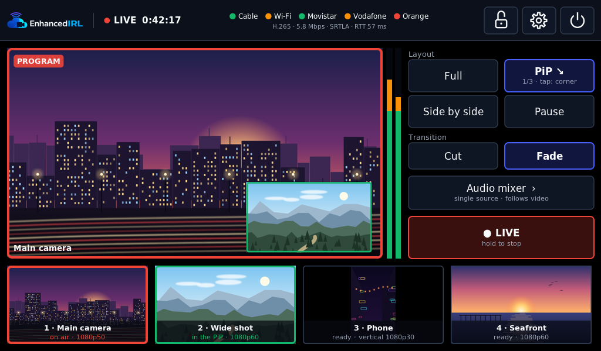
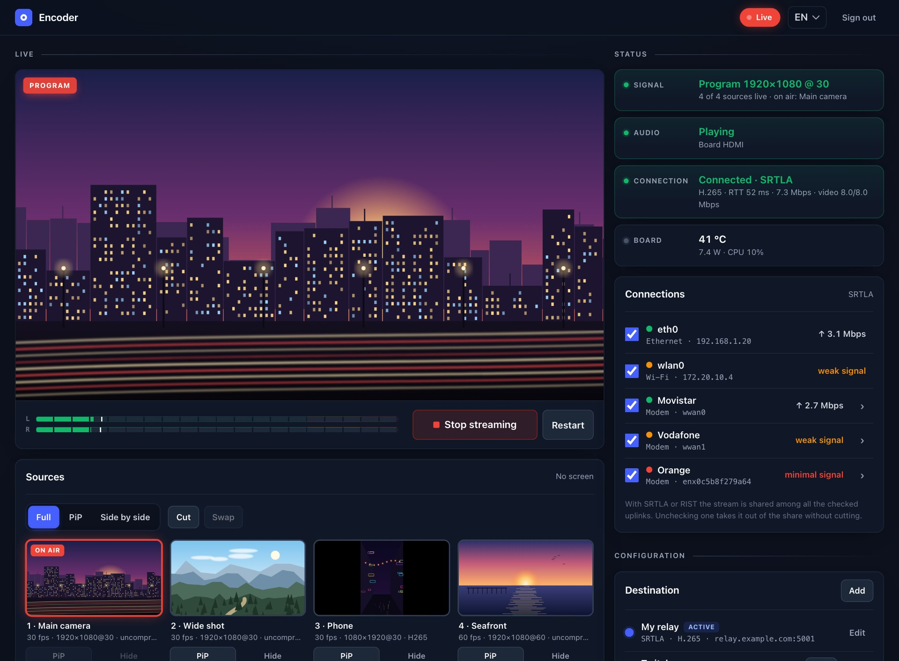
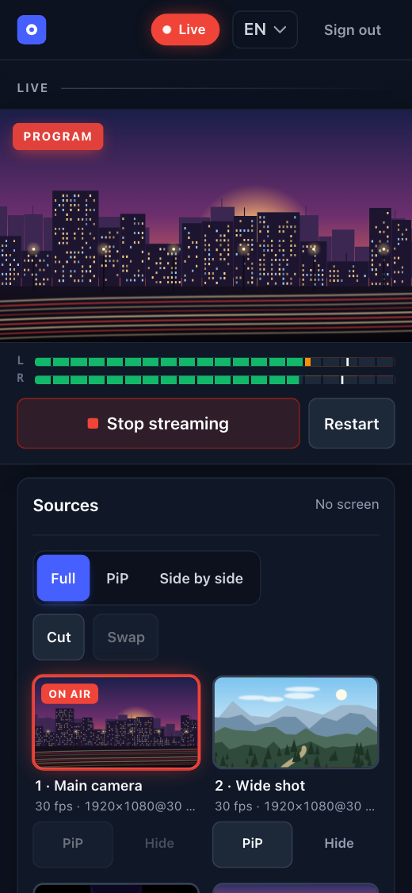
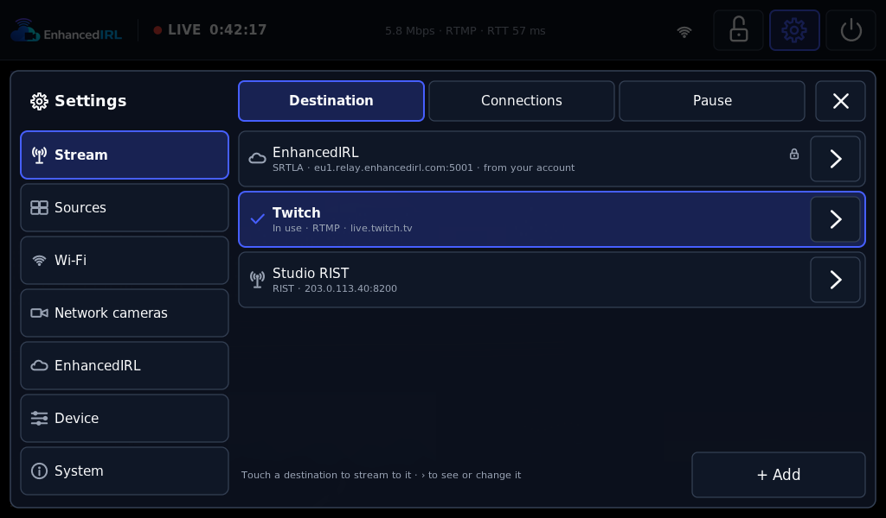
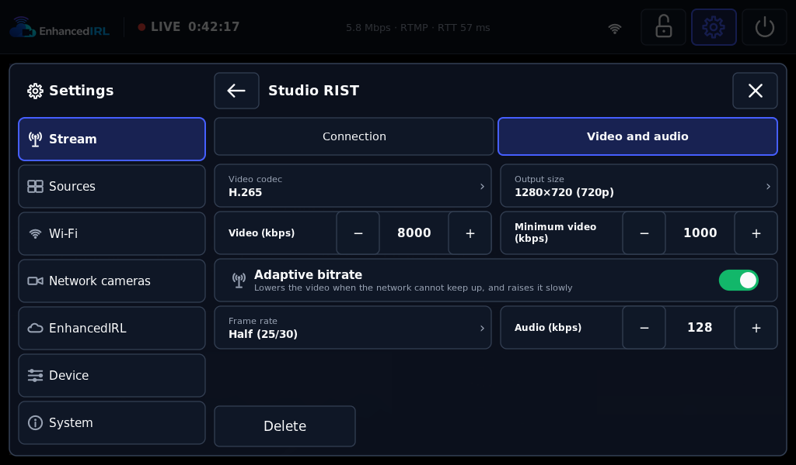
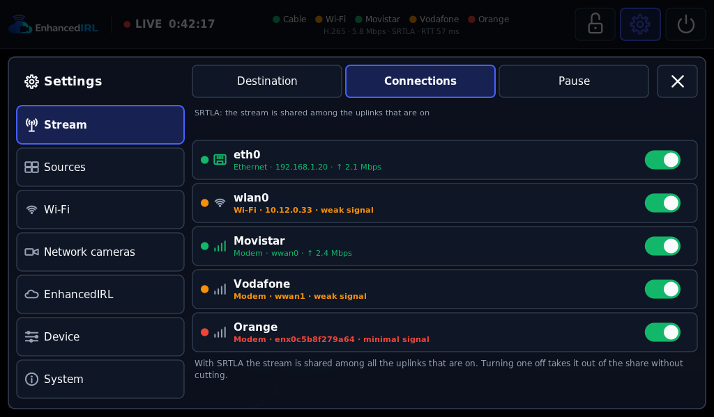
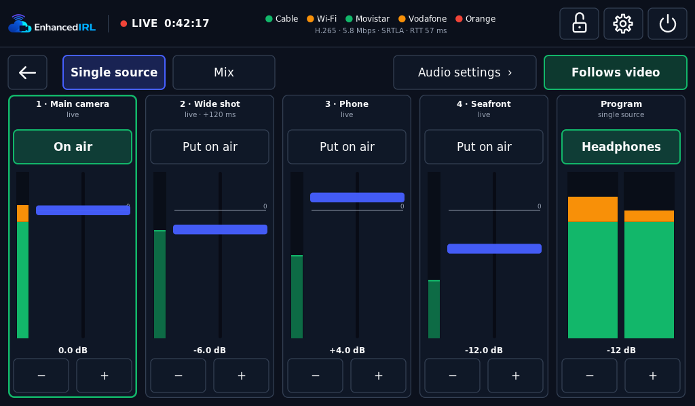
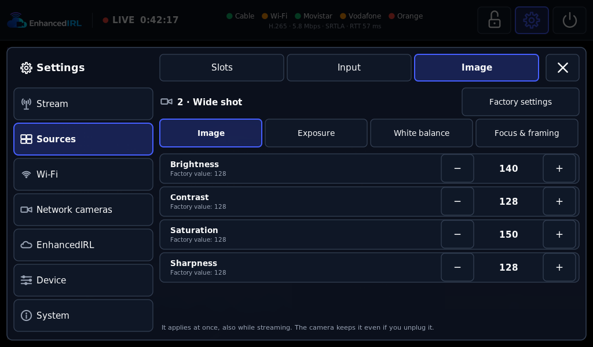

> **Status:** IN PROGRESS — released and updating itself over the air (latest: v0.11.1, Oct 23, also as a microSD image); see [Status](#status)
> **Updated:** 2026-10-28

# eirl-encoder

**eirl-encoder** is an open-source hardware encoder and live mixer for IRL ("in real life") streaming,
built on an NVIDIA **Jetson Nano**. It takes the board's HDMI input (through a **Toshiba TC358743**
HDMI-to-CSI-2 bridge), USB capture cards and cameras, and phones or cameras over the network, mixes
them from a **touch screen**, and streams the program in **H.264 or H.265** with AAC audio over **SRT,
SRTLA, RTMP, RTMPS, RIST or UDP/RTP**. With SRTLA or RIST the stream is shared across several internet
links at once (Ethernet, Wi-Fi, 4G/5G modems, phones). A **web app** runs it from a phone or a laptop,
and the encoder can optionally be linked to an EnhancedIRL account to control it from the cloud (in closed
beta).

It is free and open source, made by [EnhancedIRL](https://enhancedirl.com/?utm_source=github&utm_medium=readme&utm_campaign=eirl-encoder), the cloud service for IRL
streaming: see [Works best with EnhancedIRL](#works-best-with-enhancedirl).

<p align="center">
  
</p>

## Screenshots

| The web app (desktop) | The web app (phone) |
|---|---|
|  |  |

| Saved destinations | Video settings per destination |
|---|---|
|  |  |

| Connections (bonding) | Audio mixer |
|---|---|
|  |  |

| A USB camera's image settings | |
|---|---|
|  | |

*The screenshots are synthetic: the touch screen is drawn by `eirl-ui-render` and the web page is served by the
simulated encoder (`eirl-encoder-sim`), with illustrations in place of the cameras. `tools/screenshots/shots.sh`
draws them again.*

## Features

- **Inputs**: the board's HDMI through the TC358743 over CSI (up to 1080p50 or 720p60, with HDMI audio
  over I2S); USB capture cards (Elgato Cam Link 4K up to 1080p60, MS2130, MS2109) and UVC cameras, plugged
  in and unplugged while running; phones and cameras over RTMP or SRT (H.264 or H.265, e.g. Moblin or
  Larix), through the encoder's own Wi-Fi access point or by cable; a test pattern. Four mixer slots with
  your own names, and more cameras connected than slots if you want.
- **Camera image settings** for USB cameras that have them (brightness, contrast, saturation, sharpness,
  exposure, gain, white balance, focus, zoom, framing, anti-flicker), applied live and remembered per
  camera.
- **Live mixer** (the mixer is the encoder): cut and fade, picture-in-picture (4 corners, 2 sizes),
  side by side, a full-screen pause slate with text, letterboxing for sources that are not 16:9.
  Multiview on a 1024×600 touch screen on the board's HDMI output: put a source on air with a touch,
  hold to go live, lock the screen. The web and the screen are two views of the same state.
- **Audio independent from video**: one input or a mix, with per-input gain and delay, "audio follows
  video", and headphones on the screen's jack (the program audio over HDMI).
- **Encoding**: hardware **H.264** (High) or **H.265** (Main) with the Jetson's NVENC, and AAC. Per
  destination: codec, video and audio bitrate, adaptive bitrate, output size (the program's, 720p or
  540p) and frame rate (full or half).
- **Output protocols**:

  | Protocol | Notes |
  |---|---|
  | SRT | Caller or listener |
  | SRTLA | SRT bonded across all the enabled links, to an SRTLA receiver such as EnhancedIRL's relays |
  | RTMP / RTMPS | Straight to the platforms; H.265 over Enhanced RTMP where the platform takes it. A single connection, over the healthiest link |
  | RIST | Simple or main profile, optionally encrypted, bonded across the links |
  | UDP / RTP | MPEG-TS to the local network, unicast or multicast |

- **Saved destinations**: several destinations (templates for Twitch, YouTube, Kick and Facebook, or your
  own; a linked encoder also gets its EnhancedIRL account's), one active; switching destination while
  live brings the stream back within a second, without restarting the encoder.
- **Connections**: Ethernet, Wi-Fi client, USB 4G/5G modems (HiLink and ModemManager: PIN, APN, roaming,
  network type) and phones; a health dot per link (good, weak, no internet), and a link with no internet
  stops carrying the stream until it recovers.
- **Web app** (`eirl-encoderd`, a static Go binary): low-latency WebRTC preview with audio, level
  meters, sources, destinations, connections, Wi-Fi, network cameras, updates and logs. LAN only,
  password protected, strict input validation, least privilege (no root, exact sudo rules).
- **The board's Wi-Fi**: its own access point for cameras and phones, and a Wi-Fi client as one more
  uplink.
- **In English, Spanish and French** (the touch screen and the web), with a **first-boot setup wizard**
  (language, time zone, network, web password, the device's name, optional EnhancedIRL link, in closed beta).
- **Signed over-the-air updates** from GitHub Releases (ed25519): the encoder offers them, never installs
  while streaming, and goes back to the previous version by itself if the new one does not start.
- Boot splash, its own fan control, a slimmed-down base OS and a ready-to-flash microSD image
  ([`IMAGE.md`](IMAGE.md)): write the card, power on, follow the wizard.
- **Optional link to EnhancedIRL** (closed beta): status, thumbnails and remote control from the EnhancedIRL app.

## Getting started

Hardware: a **Jetson Nano Developer Kit 4 GB (carrier B01)**, a TC358743 HDMI-to-CSI board on CAM1 (with its
I2S lines for HDMI audio), a **5 V 4 A** power supply, a 1024×600 HDMI touch screen and a **microSD card of
16 GB or more** (a 32 GB high-endurance card is best). See [Hardware](DEVELOPMENT.md#hardware).

### From the microSD image

The image is a whole card: NVIDIA's L4T R32.7.6 with the encoder already installed, and nothing else
([`IMAGE.md`](IMAGE.md)). Its files are assets of the release whose software it carries, on
[GitHub Releases](https://github.com/enhanced-irl/eirl-encoder/releases): not every release has one, and a card
written with an older image updates itself on its first check.

1. Download `eirl-encoder-<version>-jetson-nano.img.xz` and, to check it, its `.img.json` and `.img.json.sig`.
2. Check it (optional, recommended). With this repository and Go:

   ```bash
   git clone https://github.com/enhanced-irl/eirl-encoder.git && cd eirl-encoder
   go -C manager build -o "$PWD/eirl-release" ./cmd/eirl-release
   F=~/Downloads/eirl-encoder-<version>-jetson-nano
   ./eirl-release verify-image -manifest $F.img.json -image $F.img.xz
   ```

   Exit 0: the image is the one we signed, with the same key as the updates. 1: the download does not match, do
   not write it. 2: it could not be checked (a missing file). Without Go, with OpenSSL 3 and
   `release/eirl-release.pem` of this repository (on macOS, not the LibreSSL it ships: `brew install openssl@3`):

   ```bash
   OPENSSL=openssl                      # macOS: OPENSSL=$(brew --prefix openssl@3)/bin/openssl
   $OPENSSL base64 -d -A -in $F.img.json.sig -out $F.img.json.sig.bin &&
     $OPENSSL pkeyutl -verify -pubin -inkey release/eirl-release.pem -rawin -in $F.img.json -sigfile $F.img.json.sig.bin &&
     grep -q "\"sha256\": \"$(shasum -a 256 $F.img.xz | cut -d' ' -f1)\"" $F.img.json && echo "image OK"
   ```

   "Signature Verified Successfully", then "image OK": good. Anything else: do not write it.

   (`sha256sum -c` with the `.img.xz.sha256` file only catches a damaged download, not a replaced one.)
3. Write it to the card. With [balenaEtcher](https://etcher.balena.io): pick the `.img.xz` as it is (Etcher
   decompresses it and checks what it wrote). Or with `dd`, on the card's whole device (everything on it is
   erased):

   ```bash
   xz -dc $F.img.xz | sudo dd of=/dev/<card> bs=4M conv=fsync status=progress
   ```

4. Put the card in the Nano, connect the screen and power it on. The first boot takes a few seconds more: the
   system grows to the whole card and makes the device's own identity (its name `eirl-encoder-<xxxx>` and the
   name of its Wi-Fi). If the board's firmware is older than L4T R32.7.6, that first boot also updates it, once:
   about 2 minutes more on the boot screen, then the board restarts by itself. **Keep the power connected** (the
   screen does not say yet that it is updating).
5. Follow the setup wizard on the touch screen. The web app, `http://eirl-encoder-<xxxx>.local` on the same
   network, asks for the setup code the screen shows. From then on, new versions arrive over the air
   ([`UPDATES.md`](UPDATES.md)).

The image has no login user and no SSH. It is built from Ubuntu 18.04 packages and is not Ubuntu (not affiliated
with or endorsed by Canonical), and it carries NVIDIA's software under NVIDIA's licence: the notices and where the
sources are, with our written offer for them, are in the image (`/usr/share/doc/eirl-encoder-image/`) and next to
it (`-sources.md`, `-packages.txt`).

### On a Nano you set up yourself

On **L4T R32.7.6**:

1. Build and install the TC358743 module and the device tree ([Building](DEVELOPMENT.md#building),
   [Installing on the Jetson](DEVELOPMENT.md#installing-on-the-jetson)).
2. Download the latest release from [GitHub Releases](https://github.com/enhanced-irl/eirl-encoder/releases)
   and run `sudo ./install.sh` in the extracted bundle: it installs the app, the engine, the senders and the
   units, with the output off and no destination. It relies on what L4T itself provides (GStreamer with
   NVIDIA's plugins, among others: see [Installing on the Jetson](DEVELOPMENT.md#installing-on-the-jetson)).
3. Open the touch screen, or `http://<device>.local` from a phone or a laptop on the same network, and follow
   the setup wizard. From then on, new versions arrive over the air ([`UPDATES.md`](UPDATES.md)).

## Works best with EnhancedIRL

The encoder streams anywhere on its own: Twitch, YouTube, Kick or your own server. It was built alongside
[EnhancedIRL](https://enhancedirl.com/?utm_source=github&utm_medium=readme&utm_campaign=eirl-encoder), and these are the two things it cannot do by itself:

- **A receiver for bonding.** SRTLA spreads the stream across all your links, and a server on the other end has
  to put it back together. An EnhancedIRL stream key is that server, in Europe, the US or Asia, from €5 a month,
  and you add it as a Custom SRTLA destination by pasting its publish URL.
  [How an SRTLA relay works](https://enhancedirl.com/srtla-relay?utm_source=github&utm_medium=readme&utm_campaign=eirl-encoder).
- **A real OBS in the cloud.** Cloud OBS takes your encoder's stream and runs your scenes and overlays on an
  NVIDIA GPU, with automatic scene switching: when your signal drops, viewers see your BRB scene instead of a
  frozen picture, and it switches back when you return. [Cloud OBS](https://enhancedirl.com/cloud-obs?utm_source=github&utm_medium=readme&utm_campaign=eirl-encoder).

## How it works

```
HDMI ─▶ TC358743 ─CSI─┐
USB capture / UVC ────┼─▶ mixer (nvcompositor) ─▶ program ─┬─▶ NVENC H.264/H.265 + AAC ─▶ MPEG-TS ─▶ sender ─▶ SRT · SRTLA · RTMP(S) · RIST · UDP
phones / cameras ─────┘   (network sources: RTMP/SRT       ├─▶ multiview on the touch screen (the board's HDMI output)
  (RTMP/SRT, NVDEC)        received by MediaMTX)           └─▶ small H.264 + Opus ─▶ WebRTC preview in the web
```

The engine (`eirl-engine`, Go on GStreamer 1.14) captures every source, composes the program and encodes it.
GStreamer 1.14, the one in L4T 32.7, has no `srtsink`, `rtmp2sink` or `ristsink`, so SRT, SRTLA, RTMP(S) and
RIST each have a sender process fed with the MPEG-TS: `srt-live-transmit` (Haivision SRT 1.5.7, built by
`build/srt.sh`, through a named FIFO), `srtla_send` behind it for SRTLA, our own `eirl-send` (Go, RTMP and
RTMPS) and librist's `ristsender` ([`OUTPUTS.md`](OUTPUTS.md) §4); UDP/RTP leaves straight from GStreamer. All
of them are built and shipped in the release bundle. The senders report
their state and statistics back, which drives the retries, the reasons shown to the user and the adaptive
bitrate. Changing destination only restarts the output, never the engine.

The management app (`eirl-encoderd`) serves the web and the local API, keeps the settings and the saved
destinations, manages the network (access point, Wi-Fi client, modems, link health) and the cloud link, and
talks to the engine over a local socket. Details in [`MIXER.md`](MIXER.md), [`ENGINE_GO.md`](ENGINE_GO.md)
and [`MANAGER.md`](MANAGER.md).

## Repository layout

| Path | What | Docs |
|---|---|---|
| `driver/` | Patch for L4T R32.7.6's TC358743 driver, built as an out-of-tree module | [`DEVELOPMENT.md`](DEVELOPMENT.md): "Building", "Bugs found and fixed" |
| `dt/` | Device-tree fragments: the TC358743 on the CSI port and I2S4 audio | [`DEVELOPMENT.md`](DEVELOPMENT.md): "Installing on the Jetson" |
| `edid/` | EDID generator (modes up to 1080p50, LPCM stereo 48 kHz only) | [`DEVELOPMENT.md`](DEVELOPMENT.md): "HDMI signal and EDID" |
| `build/` | Docker build (arm64) of the module, the DTB, the EDIDs, the engine, `srt-live-transmit`, `srtla_send`, `ristsender` and MediaMTX | [`DEVELOPMENT.md`](DEVELOPMENT.md): "Building" |
| `manager/cmd/eirl-engine`, `manager/internal/engine/` | The engine (Go): capture, mixer, touch screen, audio, output and senders | [`MIXER.md`](MIXER.md), [`ENGINE_GO.md`](ENGINE_GO.md), [`SOURCES.md`](SOURCES.md), [`HEADPHONES.md`](HEADPHONES.md), [`OUTPUTS.md`](OUTPUTS.md) |
| `manager/cmd/eirl-send`, `manager/internal/rtmpsend` | The RTMP/RTMPS sender | [`OUTPUTS.md`](OUTPUTS.md) |
| `scripts/`, `systemd/` | The engine's launcher (`eirl-engine-start`), its socket client (`eirl-enginectl`), the boot HDMI init and the systemd units | [`DEVELOPMENT.md`](DEVELOPMENT.md): "Operating" |
| `manager/` | The management app `eirl-encoderd` (Go: local web and API, destinations, network, modems, cloud link), the network helper `eirl-netsetup`, the fan daemon `eirl-fan`, the boot splash `eirl-splash`, a simulated encoder (`eirl-encoder-sim`), a screen renderer (`eirl-ui-render`) and the deploy files | [`MANAGER.md`](MANAGER.md), [`NETWORK_SOURCES.md`](NETWORK_SOURCES.md), [`WIFI.md`](WIFI.md), [`MODEMS.md`](MODEMS.md), [`SRTLA.md`](SRTLA.md), [`SPLASH.md`](SPLASH.md), [`SETUP.md`](SETUP.md), [`FAN.md`](FAN.md) |
| `release/`, `manager/internal/update/`, `manager/cmd/eirl-update/`, `manager/cmd/eirl-release/` | Signed releases and over-the-air updates | [`UPDATES.md`](UPDATES.md) |
| `base/`, `tools/image/` | The slimmed-down base OS and the microSD image | [`BASE.md`](BASE.md), [`IMAGE.md`](IMAGE.md) |
| `tools/`, `latency/`, `monitor/` | Deployment, release, test and measurement tools | The doc of each piece |
| `docs/screenshots/` | The pictures of this README | — |

The manual of the HDMI capture and the board (the hardware and its wiring, building, installing by hand,
operating, the measurements, the bugs found and the history of the test board) is in
[`DEVELOPMENT.md`](DEVELOPMENT.md).

## Status

| Area | State | Doc |
|---|---|---|
| HDMI capture (TC358743) | ✅ 1080p30 and 1080p50 in real streams, HDMI audio, A/V in sync to the frame, ~1.06 s end-to-end latency. Open: the audio PLL that sometimes does not lock again, a DSLR that does not decode | [`DEVELOPMENT.md`](DEVELOPMENT.md) |
| USB sources | ✅ Released: Cam Link 4K at 1080p60, UVC webcams; plugging and unplugging while running (0.6.0); image settings (0.4.0). Missing: per-source A/V sync and a long test | [`SOURCES.md`](SOURCES.md) |
| Mixer, touch screen and audio | ✅ Released: 4 slots, layouts, fades, audio mixer, headphones; Settings on the screen with everything the web has | [`MIXER.md`](MIXER.md), [`HEADPHONES.md`](HEADPHONES.md) |
| Network cameras | ✅ Released: RTMP/SRT over the encoder's Wi-Fi or by cable; for now, one network camera at a time | [`NETWORK_SOURCES.md`](NETWORK_SOURCES.md) |
| Output protocols and codecs | ✅ Released in 0.5.0 (SRT, SRTLA, RTMP, RTMPS, RIST, UDP; H.264/H.265; saved destinations). First version: tests with real platform keys still to come | [`OUTPUTS.md`](OUTPUTS.md) |
| SRTLA and adaptive bitrate | ✅ Released; tested over loopback and with a real link to EnhancedIRL. Tests with several real links are next | [`SRTLA.md`](SRTLA.md) |
| 4G/5G modems and link health | 🟡 Released in 0.3.0 as a first version (HiLink modems), tested against fakes and the simulator; real-modem tests are next | [`MODEMS.md`](MODEMS.md) |
| iPhone over USB | ✅ From 0.11.1, over the air for every board and in its SD card image: an iPhone sharing its data by cable is one more link (0.8.0 and 0.11.0 carried it without a link: §12.2) | [`MODEMS.md`](MODEMS.md) §12 |
| Wi-Fi (access point and client) | ✅ Released; measurements and the cloud's side are next | [`WIFI.md`](WIFI.md) |
| Web app | ✅ Released, reviewed (code and security) | [`MANAGER.md`](MANAGER.md) |
| Setup wizard, translations | ✅ Released in 0.1.0 | [`SETUP.md`](SETUP.md) |
| Over-the-air updates | ✅ Released in 0.1.0; since 0.11.0 they also bring drivers, firmware and system packages (the system layer), so a card never has to be written again; the test board updates itself from GitHub Releases like any device | [`UPDATES.md`](UPDATES.md) |
| Fan control | ✅ Released in 0.6.0 (one curve); profiles next | [`FAN.md`](FAN.md) |
| Boot splash | ✅ Released | [`SPLASH.md`](SPLASH.md) |
| microSD image | ✅ Published with 0.7.0, 0.8.0 and 0.11.1: the whole card, signed with the updates' key. The one-time firmware update is still to be seen on a board with older firmware | [`IMAGE.md`](IMAGE.md) |

## Community and support

- **Questions, builds and ideas**: the [EnhancedIRL Discord](https://enhancedirl.com/discord), in English.
- **Bugs**: [GitHub issues](https://github.com/enhanced-irl/eirl-encoder/issues/new/choose), with your version
  and your hardware.
- **Security vulnerabilities**: privately, as [`SECURITY.md`](SECURITY.md) explains.
- **Contributing**: [`CONTRIBUTING.md`](CONTRIBUTING.md).

## License

Apache License 2.0 ([`LICENSE`](LICENSE)), except `driver/` and `dt/`, which derive from the Linux
kernel and are GPL-2.0-only ([`driver/LICENSE`](driver/LICENSE), [`dt/LICENSE`](dt/LICENSE)).
